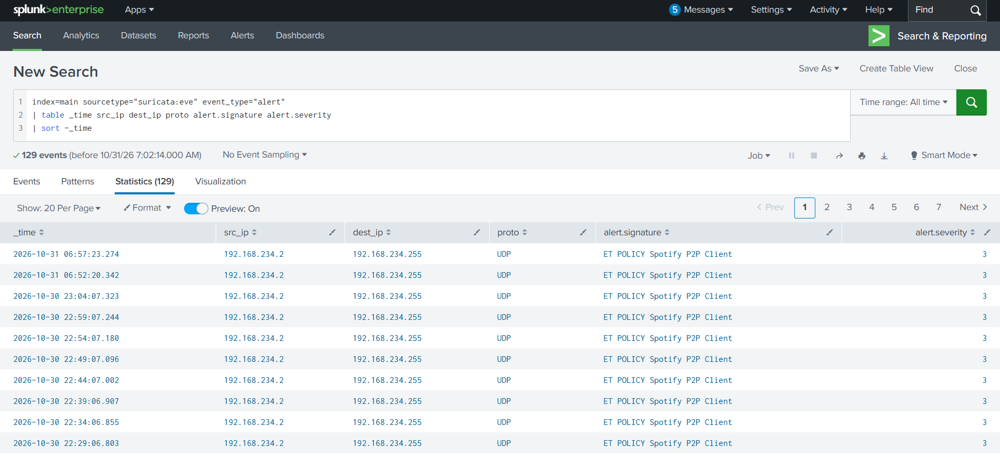
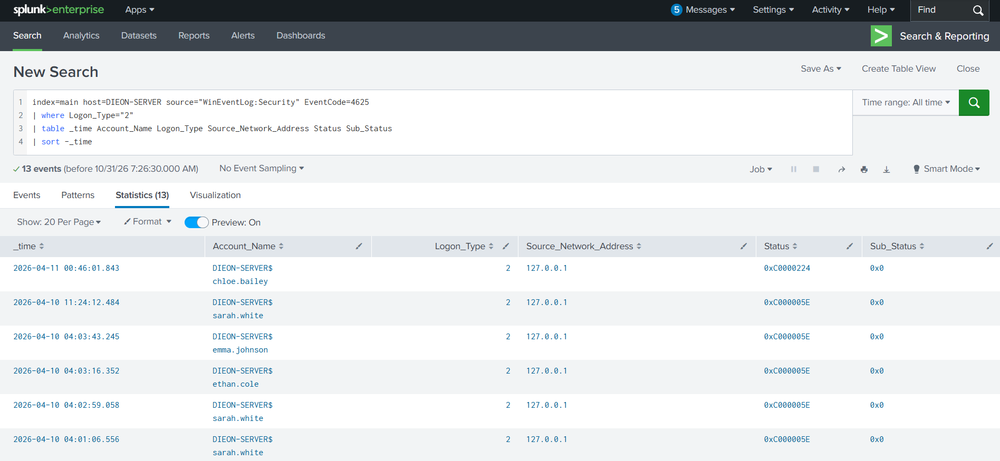
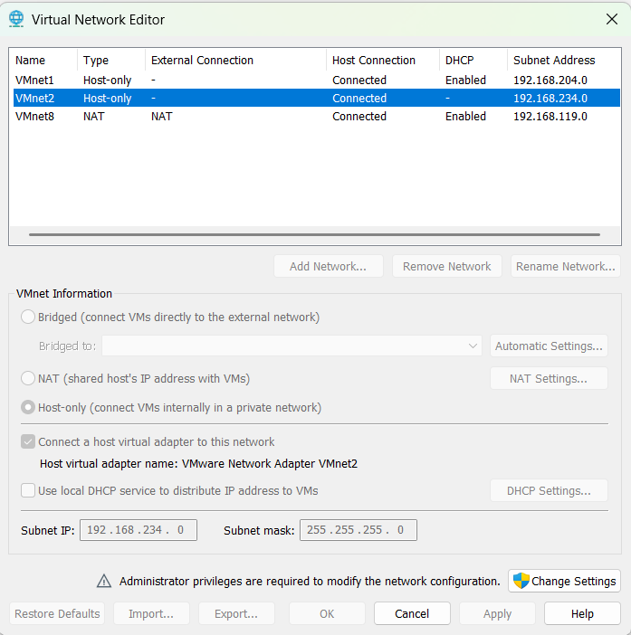

# SOC Detection Engineering Lab

A hands-on security operations center (SOC) lab built to collect and investigate **network, firewall, and Windows endpoint telemetry** in Splunk. The project combines a VMware-hosted Active Directory environment, centralized audit policies, Sysmon, pfSense, Zeek, and Suricata to practice Tier 1 SOC investigation and detection engineering.

> **Scope:** Educational, isolated home lab. The project demonstrates log collection, visibility testing, practical searches, and triage. It is not a production SOC or evidence of a real-world intrusion.

## Project objectives

- Build a reusable, segmented VMware SOC lab with a dedicated host-only subnet.
- Centralize Windows Security, PowerShell, Sysmon, pfSense, Zeek, and Suricata telemetry in Splunk.
- Validate that network sensors and forwarding pipelines are functioning.
- Investigate a network IDS alert and Windows authentication failures.
- Document results, limitations, and troubleshooting for a cybersecurity portfolio.

## Architecture

```text
                      Windows host / VMware Workstation
                      VMnet2 host-only: 192.168.234.0/24
                      Host VMnet2 adapter: 192.168.234.2
                                      |
                         +------------+-------------+
                         |  Isolated SOC lab segment |
                         +------------+-------------+
                                      |
          +---------------------------+--------------------------+
          |                 |                   |                 |
   pfSense LAN        Splunk Enterprise   Windows AD / GPO    Zeek / Suricata
   192.168.234.1      192.168.234.20      192.168.234.10      192.168.234.30
   WAN: VMnet8         UDP syslog: 5514   DAVES-SERVER         mydfir-netlab
   (NAT)              Forwarders: 9997   Domain controller    Capture: ens37
          |                 ^                   |
          |                 |              Windows member host
          |                 +-------------- DIEON-SERVER
          |                                192.168.234.101
          |                                Sysmon + Windows logs
          |
          +---- pfSense firewall/system syslog ----> Splunk

   Zeek conn.log / dns.log ------------------------> Splunk Universal Forwarder
   Suricata eve.json ------------------------------> Splunk Universal Forwarder
   Windows Security / PowerShell / Sysmon ---------> Splunk Universal Forwarder
```

**Visibility note:** VMnet2 provides a shared lab segment, but a sensor connected to the segment is **not guaranteed to see all unicast traffic between all VMs**. Packet capture and Zeek were verified for one Windows-host-to-pfSense ICMP path; this should not be interpreted as full network TAP/SPAN coverage.

### Components

| Component | Platform / role | Lab address or interface |
|---|---|---|
| pfSense CE 2.9.0 | Firewall, routed WAN/LAN, syslog | LAN `192.168.234.1` / VMnet2; WAN on VMnet8 NAT |
| Splunk Enterprise | Central log search and investigation | `192.168.234.20` |
| DAVES-SERVER | Windows Server 2025 Active Directory / Group Policy | `192.168.234.10` |
| DIEON-SERVER | Domain-joined Windows member host, auditing and Sysmon | `192.168.234.101` |
| mydfir-netlab | Ubuntu 22.04 sensor running Zeek 6.1.1 and Suricata 7.0.2 | VMnet2 `ens37`: `192.168.234.30` |
| VMware Workstation | VMnet2 virtual host-only network | `192.168.234.0/24`, VMware DHCP disabled |

The sensor also retains its separate original network interface for administration. No claim is made that every lab system sends all traffic through pfSense.

## Implementation and validation

### 1. VMware segmentation and pfSense

A dedicated **VMnet2 host-only** network was configured with subnet `192.168.234.0/24` and VMware DHCP disabled. pfSense was configured with a VMnet8 NAT-facing WAN and VMnet2 LAN.

In pfSense, remote logging was enabled for **system and firewall events**, using UDP to `192.168.234.20:5514`. Splunk's UDP input was configured with sourcetype `pfsense`, and both passed and blocked firewall log entries were observed in Splunk.

**Validation search:**

```spl
index=main sourcetype="pfsense" "filterlog"
| table _time host _raw
| head 10
```

### 2. Windows Active Directory and endpoint telemetry

A dedicated `SOC-Detection-Lab` organizational unit was created beneath `drizlabs` in the `corp.ybndave.com` domain. The `SOC-Lab-Security-Auditing` Group Policy Object was linked to that OU to support centralized auditing.

The domain-joined test machine `DIEON-SERVER` was configured to provide:

- Windows Security events such as **4625** (failed logon) and **4688** (process creation).
- PowerShell Operational logging, including script block event **4104**.
- Sysmon process creation event **1**, using the SwiftOnSecurity configuration.
- Windows log forwarding into Splunk using a Universal Forwarder.

**Sysmon validation search:**

```spl
index=main host=DIEON-SERVER source="WinEventLog:Microsoft-Windows-Sysmon/Operational" EventCode=1
| table _time User Image CommandLine ParentImage
| head 10
```

### 3. Zeek and Suricata network monitoring

The Ubuntu network sensor was configured to monitor `ens37` on VMnet2:

- **Zeek 6.1.1:** Updated `/opt/zeek/etc/node.cfg` to capture on `ens37` and deployed using `zeekctl`.
- **Suricata 7.0.2:** Corrected the `af-packet` interface in `/etc/suricata/suricata.yaml` from the nonexistent `eth0` to `ens37`.
- **Splunk Universal Forwarder:** Forwarded Zeek `conn.log` and `dns.log`, and Suricata `eve.json`, to Splunk on port `9997`.

The configured Splunk sourcetypes were:

| Sourcetype | Data |
|---|---|
| `zeek:conn` | Network connection metadata |
| `zeek:dns` | DNS transaction metadata |
| `suricata:eve` | Suricata EVE JSON events and alerts |
| `pfsense` | pfSense syslog |
| `WinEventLog:Security` | Windows security events |
| `WinEventLog:Microsoft-Windows-Sysmon/Operational` | Sysmon events |

**Network telemetry validation:**

```spl
index=main (sourcetype="zeek:conn" OR sourcetype="zeek:dns")
| stats count by sourcetype
```

```spl
index=main sourcetype="suricata:eve"
| stats count by event_type
| sort -count
```

A controlled `ping -n 10 192.168.234.1` from the Windows host was observed with `tcpdump` on `ens37` (10 echo requests and 10 replies). Zeek also generated a corresponding connection record in Splunk, showing that **this specific traffic path** was visible to the sensor.

## SOC investigation 1 — Suricata policy alert triage

**Objective:** Review an IDS alert to determine whether its context supports escalation.

**Splunk search:**

```spl
index=main sourcetype="suricata:eve" event_type="alert"
| table _time src_ip dest_ip src_port dest_port proto alert.signature alert.category alert.signature_id alert.severity
| sort -_time
```

### Observations

| Attribute | Observed value |
|---|---|
| Signature | `ET POLICY Spotify P2P Client` |
| Signature ID | `2027397` |
| Category | `Not Suspicious Traffic` |
| Source | `192.168.234.2` (Windows host VMnet2 interface) |
| Destination | `192.168.234.255` (VMnet2 broadcast address) |
| Protocol | UDP |
| Port | `57621` |
| Rule severity | 3 (low-priority rule) |
| Alert count at investigation | 12 |

### Assessment

**Likely benign local broadcast/application-discovery activity.** The detection matched a policy rule associated with Spotify-related traffic, and the destination was the local subnet broadcast address. The available evidence did **not** establish malicious activity.

The responsible Windows process was **not independently verified**, so this is a *likely benign* assessment rather than a confirmed process-attributed false positive. No MITRE ATT&CK technique mapping is justified from these observations alone.

**SOC takeaway:** Rule matches require context. Signature name, category, source, protocol, and destination can prevent unnecessary escalation.

## SOC investigation 2 — Windows failed interactive logons

**Objective:** Identify and interpret failed Windows sign-ins without assuming that every failure is a brute-force attack.

**Splunk search:**

```spl
index=main host=DIEON-SERVER source="WinEventLog:Security" EventCode=4625
| where Logon_Type="2"
| table _time Account_Name Logon_Type Source_Network_Address Status Sub_Status
| sort -_time
```

### Observations

- The broader query returned **174 Event ID 4625 records** at the time of investigation.
- Filtering for **Logon Type 2 (interactive)** returned **13 events**.
- Named accounts appeared in the results, including `sarah.white`, `james.smith`, and `ethan.cole`.
- The displayed source network address for these interactive failures was `127.0.0.1` (IPv4 loopback).
- The evidence included status/substatus values such as:
  - `0xC000006D`: General logon failure.
  - `0xC0000064`: User account does not exist.
  - `0xC000005E`: No logon servers were available.
  - `0xC0000224`: User must change password before logging on.
- Some Splunk `Account_Name` fields were multivalued and also included a machine-account name. These should not be mistaken for multiple distinct attackers.

### Assessment

**Authentication failures confirmed; brute-force attack not confirmed.** The observed data included incorrect/unknown account attempts and authentication-environment conditions. Loopback addressing does not establish an external remote origin.

The Splunk search was saved as a report named **`SOC Lab - Windows Failed Interactive Logons`**.

**SOC takeaway:** Event IDs alone are insufficient. Logon type, failure status, account context, source information, and event grouping matter before escalation.

## Troubleshooting highlights

| Issue | Resolution / lesson |
|---|---|
| Windows host VMnet2 addressing conflicted with the planned pfSense LAN IP | Assigned the host VMnet2 adapter `192.168.234.2`, reserving `192.168.234.1` for pfSense |
| Suricata monitored nonexistent `eth0` | Changed its `af-packet` interface to `ens37`, tested configuration, restarted service |
| Zeek originally monitored the wrong interface | Set `interface=ens37` in `node.cfg` and redeployed via `zeekctl` |
| pfSense syslog initially needed a Splunk listener | Added a UDP `5514` input, sourcetype `pfsense`, and confirmed `filterlog` events |
| Zeek/Suricata logs needed central ingestion | Installed/configured Splunk Universal Forwarder on the sensor and verified events by sourcetype |
| Initial sensor traffic check did not show the desired packets | Generated a specific, harmless ICMP test and verified packets with `tcpdump` and the corresponding Zeek log |
| A failed-logon search with account exclusions returned zero events | Simplified the SPL and filtered on `Logon_Type="2"`, recovering the relevant results |
| Splunk Free license lacks scheduled alerting in this lab | Used interactive searches and saved reports, without claiming a running scheduled detection |

## Portfolio evidence

The following screenshots are included in the repository under [`evidence/`](evidence/). Select any screenshot link to view the original image:

| Screenshot | What it demonstrates |
|---|---|
| [`01-suricata-alerts.png`](evidence/01-suricata-alerts.png) | Suricata IDS policy alerts visible in Splunk |
| [`02-zeek-network-logs.png`](evidence/02-zeek-network-logs.png) | Zeek connection and DNS telemetry in Splunk |
| [`03-pfsense-firewall-logs.png`](evidence/03-pfsense-firewall-logs.png) | pfSense firewall syslog ingested in Splunk |
| [`04-sysmon-process-creation.png`](evidence/04-sysmon-process-creation.png) | Sysmon process creation events from DIEON-SERVER |
| [`05-windows-failed-logons.png`](evidence/05-windows-failed-logons.png) | Event ID 4625 interactive logon investigation |
| [`06-active-directory-security-gpo.png`](evidence/06-active-directory-security-gpo.png) | AD organizational unit and linked audit GPO |
| [`07-vmnet2-network-architecture.png`](evidence/07-vmnet2-network-architecture.png) | Host-only VMnet2 subnet and disabled VMware DHCP |

**Evidence status:** All seven screenshots uploaded and linked below. Screenshots are lab artifacts, not evidence of a production incident.

### Selected evidence previews

**Suricata policy alert triage**



**Windows failed interactive logons**



**VMware host-only SOC segment**



## Limitations and future improvements

- **Network monitoring coverage:** Host-only segment membership does not automatically equal a network mirror. A virtual TAP/SPAN, appropriate inline gateway routing, or a dedicated mirrored traffic source would be needed to assess broader inter-VM coverage.
- **Detection response:** Splunk searches and a saved report were validated. This project does not claim continuously scheduled detection or automated incident response.
- **Alert attribution:** The Spotify-related policy alert was not tied to a verified endpoint process.
- **Security conclusions:** The observed authentication failures are not evidence of a confirmed external attacker.
- **Potential enhancements:** Controlled benign simulations, risk-based correlation, ATT&CK mapping where supported by actual behaviors, and structured analyst case records.

## Skills demonstrated

**SOC monitoring · Detection engineering fundamentals · Splunk SPL · Windows Event Log analysis · Sysmon telemetry · Active Directory auditing · Group Policy · Firewall syslog ingestion · Zeek network metadata · Suricata IDS triage · Packet capture validation · VMware networking · Troubleshooting · Evidence-based incident assessment**

---

**Project status:** Core infrastructure, two practical investigations, and seven portfolio evidence screenshots completed.
